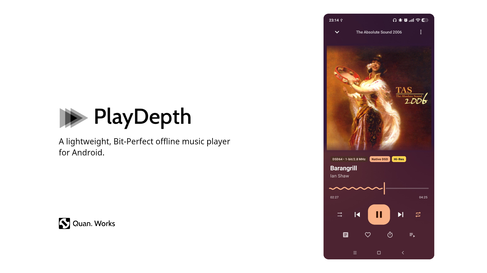
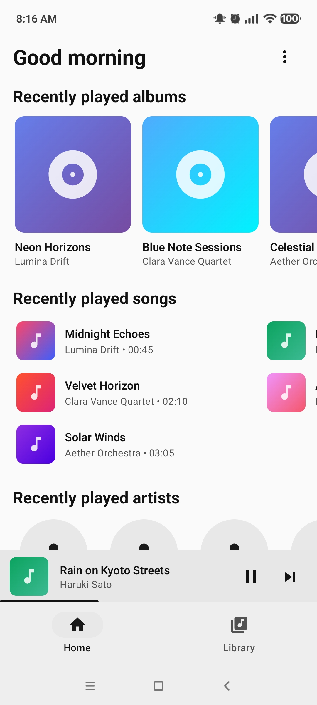
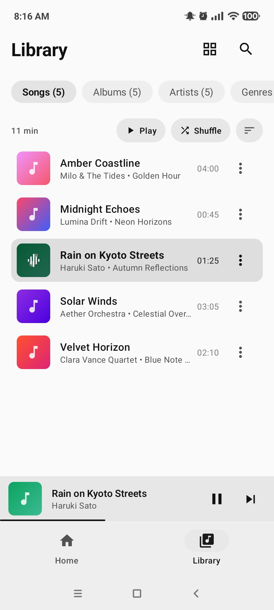
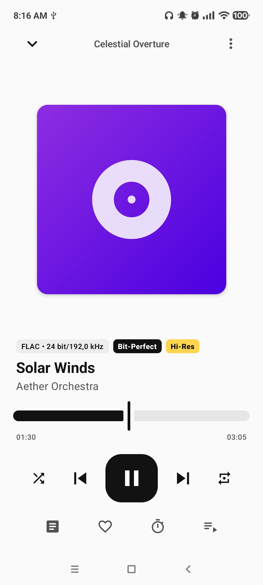
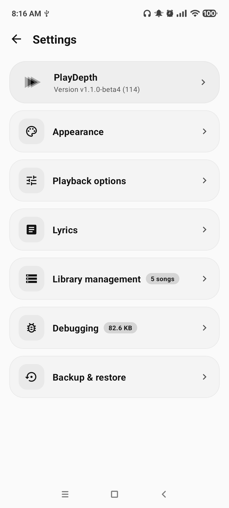

# PlayDepth

**PlayDepth** is an offline, Hi-Res & Bit-Perfect USB DAC music player for Android, built with Jetpack Compose, Material 3, AndroidX Media3, FFmpeg, and a custom native C++17 `usbdevfs` UAC 1.0/2.0/3.0 driver.

> **Project Scope**
>
> PlayDepth is a **personal project** published primarily for **transparency and auditability** — allowing users to inspect how local files, permissions, and USB audio hardware are handled, or build the app from source.
> Please read [CONTRIBUTING.md](CONTRIBUTING.md) before opening an issue.

---

## Features

- **Bit-Perfect USB DAC Output (No Root Required):** Direct userspace USB Audio Class (UAC 1.0 / 2.0 / 3.0) streaming via native C++17 `usbdevfs` isochronous transfers, bypassing Android's `AudioFlinger` resampling. Includes asynchronous feedback clock sync, UAC hardware volume control, and Native DSD / DoP / DSD-to-PCM support.
- **Broad Audio Format Support:** Plays FLAC, WAV (including 32-bit float), AIFF/AIFC, DSF/DFF (DSD), ALAC, APE, WMA, MP3, AAC, and Opus using AndroidX Media3 (`ExoPlayer`), Jellyfin `media3-ffmpeg-decoder`, and custom container extractors.
- **Offline Library & Metadata:** Hybrid MediaStore + direct filesystem scanner, SQLite-backed playlists, favorites, and listening history, deduplicated album artwork caching, offline synced (`.lrc`) and static lyrics, and detailed audio spec inspection.
- **Adaptive Material 3 UI:** Built 100% in Jetpack Compose for phones and tablets, featuring both **Classic** and **Modern** edge-to-edge Now Playing styles, drag-and-drop queue reordering, and alphabetical fast scrolling. Localized in English and Vietnamese.
- **Built-in Diagnostics:** Real-time USB DAC telemetry sheet and a ring-buffered debug logger with shareable diagnostic reports for troubleshooting hardware compatibility.

---

## Screenshots

|  |  |
| -------------------------------------------------------------------------------------------------- | -------------------------------------------------------------------------------------------------- |
|  |  |

---

## Tech Stack

| Layer             | Technologies                                                                                                           |
| :---------------- | :--------------------------------------------------------------------------------------------------------------------- |
| **Languages**     | Kotlin (JVM 17), C++17 (Android NDK)                                                                                   |
| **UI**            | Jetpack Compose (`compose-bom:2024.10.01`), Material 3, Coil `2.7.0`                                                   |
| **Audio & Media** | AndroidX Media3 `1.5.0`, Jellyfin `media3-ffmpeg-decoder:1.5.0+1`, custom JNI + `usbdevfs` driver (`playdepth_usbdac`) |
| **Storage**       | SQLite (`SQLiteOpenHelper`), Jetpack DataStore Preferences                                                             |
| **Platform**      | Android 8.0+ (`minSdk 26`, `targetSdk 35`) · ABIs: `arm64-v8a`, `armeabi-v7a`                                          |

---

## Building from Source

### Prerequisites

- **JDK 17**
- **Android SDK** with API 35 (Android Studio or command-line tools)
- **Android NDK** `29.0.14206865` and **CMake** `3.22.1`

### Commands

```bash
# Build debug APK
./gradlew assembleDebug

# Run unit tests
./gradlew testDebugUnitTest

# Build release APK
./gradlew assembleRelease
```

---

## Project Layout

```text
app/src/
├── main/
│   ├── cpp/       # Native C++17 UAC 1.0/2.0/3.0 USB DAC driver & JNI bridge
│   ├── java/      # Kotlin app code (audio, data, scanner, service, ui, util)
│   └── res/       # Resources & localization (English default, Vietnamese)
└── test/          # JUnit unit tests
```

See [CONVENTIONS.md](CONVENTIONS.md) for coding guidelines and the full module map.

---

## Notice

Follow me on [Telegram channel](https://t.me/playdepth) for more infomations.

---

## Credits

PlayDepth builds on the following open-source libraries:

- [AndroidX Media3](https://github.com/androidx/media) — Playback engine & `MediaSessionService`
- [Jellyfin Media3 FFmpeg Decoder](https://github.com/jellyfin/jellyfin-androidx-media) / [FFmpeg](https://ffmpeg.org/) — Software audio decoding fallback
- [Coil](https://github.com/coil-kt/coil) — Image loading and caching
- [Reorderable](https://github.com/Calvin-LL/Reorderable) — Drag-and-drop queue reordering
- [fastscroller-compose-multiplatform](https://github.com/oikvpqya/fastscroller-compose-multiplatform) — Alphabetical fast scroller
- [Jetpack Compose & Material 3](https://developer.android.com/jetpack/compose)

---

## License

Licensed under the **GNU General Public License v3.0 (GPL-3.0)**. See [LICENSE](LICENSE) for details.
